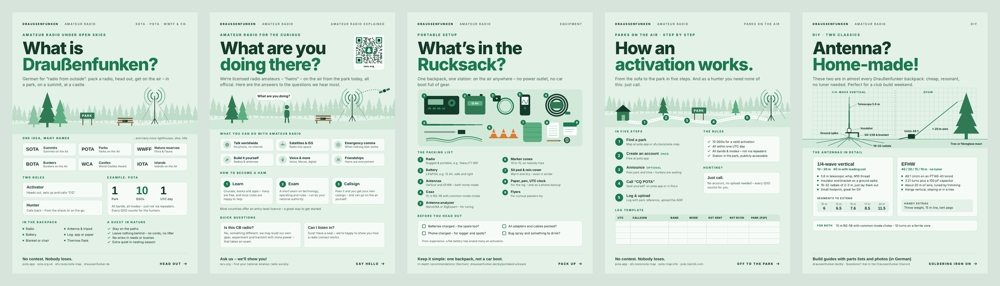
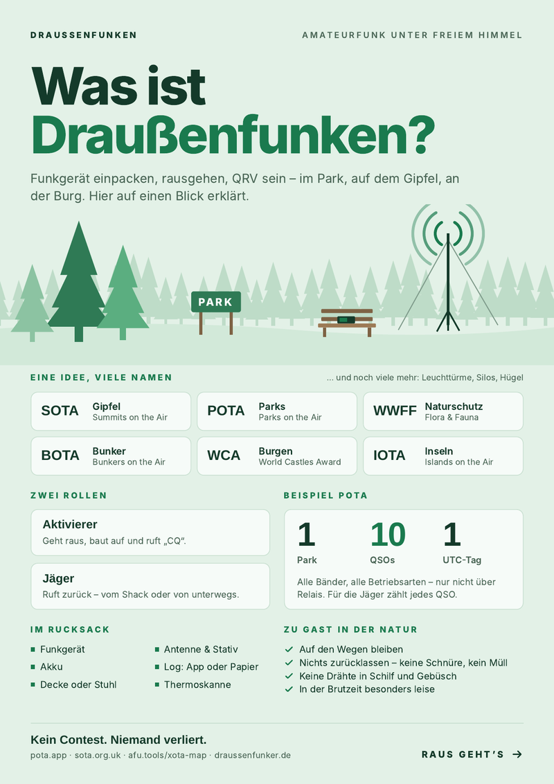
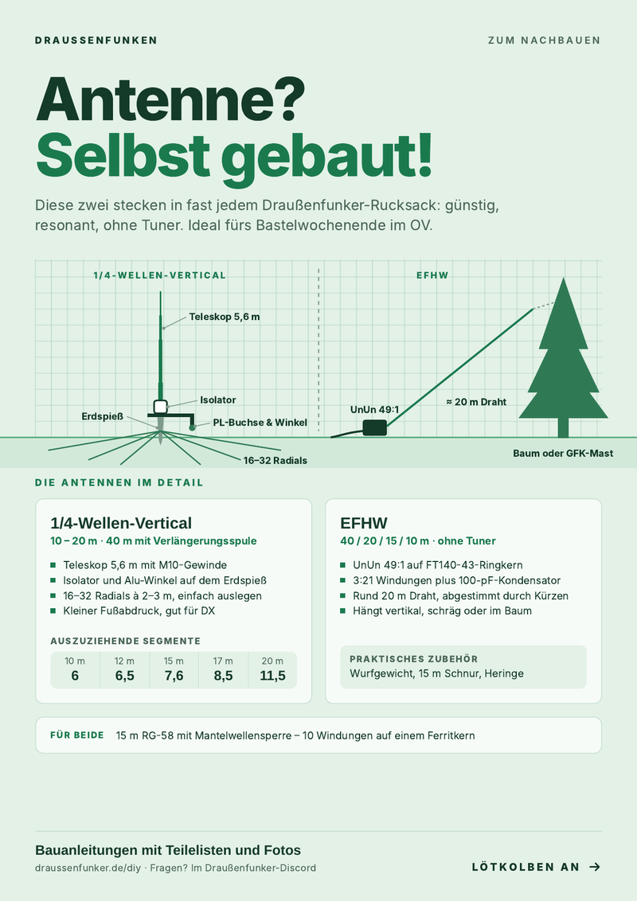
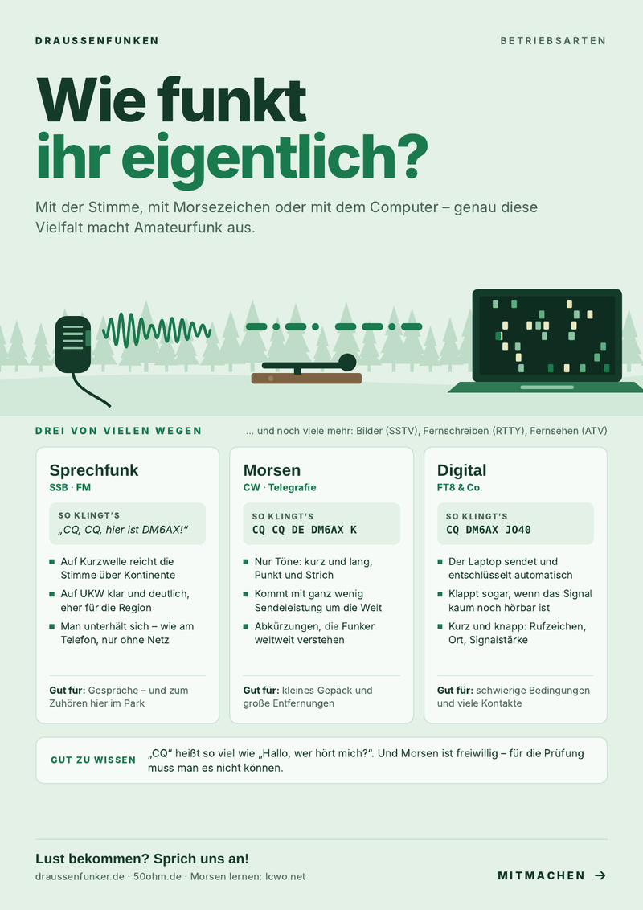
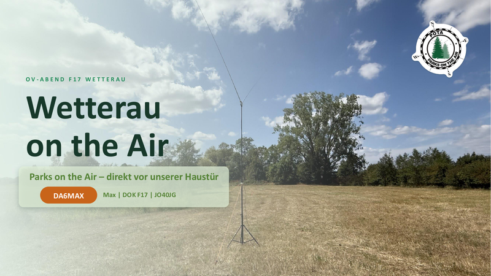

# Draußenfunken – Posterserie

Sechs A4-Poster und ein Flyer rund ums Draußenfunken – zum Aushängen im OV-Heim, Auslegen bei Aktivierungen oder Verteilen an Neugierige.
Die Poster sind unabhängig voneinander und können in beliebiger Kombination genutzt werden.


**Online ansehen und herunterladen:** <https://mooxle.github.io/draussenfunken-poster/>

**Mitmachen:** Verbesserungen und neue Poster sind willkommen – siehe [CONTRIBUTING.md](CONTRIBUTING.md).

## Draußenfunker?

*A German word worth borrowing:*

> **Draußenfunker** /ˈdʁaʊ̯sn̩ˌfʊŋkɐ/ · *noun, German* · also written *Draussenfunker*
>
> 1. Literally „outdoor radio operator“ – from *draußen* (outside) + *Funker* (radio operator).
> 2. A ham who would rather operate from a park, a summit or a bench than from the shack. Also the name of the German community at [draussenfunker.de](https://draussenfunker.de).
>
> Like *Kindergarten* or *Rucksack*, some German words just travel well – so we keep this one as it is.

## English

All posters and the flyer are also available in English – in `poster/en/`, with PDFs in `pdf/en/`.
The poster for passers-by (*What are you doing there?*) is written for an international audience and points to the
[IARU](https://www.iaru.org) instead of German regulations.

**View and download:** <https://mooxle.github.io/draussenfunken-poster/poster/en/>



The talk **“Wetterau on the Air”** – an introduction to portable operating and POTA for club evenings – is available in English too,
as PDF and as PowerPoint to adapt: see [`vortrag/`](vortrag/).

## Die Poster

<table>
  <tr>
    <td width="33%" valign="top">
      <a href="screenshots/was-ist-draussenfunken.png"></a>
      <p><b>Was ist Draußenfunken?</b><br>
      Das Hauptposter: die Idee hinter SOTA, POTA, WWFF &amp; Co., Aktivierer und Jäger, POTA in drei Zahlen, Packliste und Rücksicht in der Natur.<br>
      <code>poster/was-ist-draussenfunken.html</code></p>
    </td>
    <td width="33%" valign="top">
      <a href="screenshots/was-macht-ihr-da.png"></a>
      <p><b>Was macht ihr da eigentlich?</b><br>
      Für Passanten: was Amateurfunk ist, was man damit machen kann und wie man Funkamateur wird (Klassen N, E, A).<br>
      <code>poster/was-macht-ihr-da.html</code></p>
    </td>
    <td width="33%" valign="top">
      <a href="screenshots/rucksack.png"></a>
      <p><b>Was steckt im Rucksack?</b><br>
      Das Portabel-Setup als nummerierte Packliste plus Checkliste „Vor dem Losgehen“.<br>
      <code>poster/rucksack.html</code></p>
    </td>
  </tr>
  <tr>
    <td width="33%" valign="top">
      <a href="screenshots/aktivierung.png"></a>
      <p><b>So läuft eine Aktivierung</b><br>
      POTA in fünf Schritten, die Regeln, der Hinweis für Jäger und eine Log-Vorlage zum Ausfüllen.<br>
      <code>poster/aktivierung.html</code></p>
    </td>
    <td width="33%" valign="top">
      <a href="screenshots/antennen.png"></a>
      <p><b>Antenne? Selbst gebaut!</b><br>
      Teleskop-Vertical und EFHW mit Skizze, Eckdaten und Tabelle der auszuziehenden Segmente.<br>
      <code>poster/antennen.html</code></p>
    </td>
    <td width="33%" valign="top">
      <a href="screenshots/betriebsarten.png"></a>
      <p><b>Wie funkt ihr eigentlich?</b><br>
      Sprechfunk, Morsen, Digital – drei von vielen Betriebsarten, verständlich für Passanten. Die Rückseite des Flyers.<br>
      <code>poster/betriebsarten.html</code></p>
    </td>
  </tr>
</table>

Fertige Druckdateien liegen in `pdf/`, die englischen in `pdf/en/`.

### Flyer

`pdf/flyer.pdf` ist ein doppelseitiger Flyer zum Mitgeben an Passanten: vorne „Was macht ihr da eigentlich?“, hinten „Wie funkt ihr eigentlich?“.
Beidseitig drucken und an der langen Kante wenden. Die Quelle `poster/flyer.html` bindet die beiden Poster direkt ein – Änderungen an den Postern landen
damit automatisch auch im Flyer. Englische Fassung: `pdf/en/flyer.pdf`.

## Ansehen

`poster/index.html` im Browser öffnen – von dort sind alle Poster verlinkt.

## Bearbeiten

Jedes Poster ist eine einzelne HTML-Datei ohne Build-Schritt oder Framework. Einfach im Texteditor öffnen, Text ändern, im Browser neu laden.

- **Texte** stehen direkt im HTML.
- **Farben** stehen zentral in `poster/style.css` (Abschnitt `:root`). Eine Änderung dort wirkt auf alle Poster –
  z. B. `--accent` für die Akzentfarbe.
- **Illustrationen** sind Inline-SVG direkt im Poster. Farben dort ebenfalls über die CSS-Variablen (`style="fill: var(--green)"`).
- **Größe:** Ein Poster ist genau 794 × 1123 px = A4 bei 96 dpi. Der Inhalt darf nicht über diese Fläche hinauswachsen –
  nach Textänderungen also im Browser prüfen, ob nichts abgeschnitten wird oder über Kästen hinausläuft.

Schriften: [Inter und Inter Tight](https://fonts.google.com/specimen/Inter) (SIL Open Font License), geladen über Google Fonts.
Zum Bearbeiten und Drucken wird deshalb eine Internetverbindung gebraucht.

## Drucken / PDF erzeugen

**Im Browser:** Poster öffnen → Drucken → Papierformat A4, Ränder „Keine“, Hintergrundgrafiken an → „Als PDF sichern“.

**Per Kommandozeile** (alle Poster auf einmal, braucht Google Chrome):

```sh
./make-pdf.sh
```

Das Skript schreibt die PDFs nach `pdf/` und `pdf/en/`.

## Screenshots aktualisieren

Die Bilder in `screenshots/` sind aus den PDFs gerendert. Nach Änderungen an einem Poster erst die PDFs neu erzeugen,
dann zum Beispiel mit Poppler (`brew install poppler`):

```sh
for f in pdf/*.pdf; do pdftoppm -r 96 -png -singlefile "$f" "screenshots/$(basename "$f" .pdf)"; done
for f in pdf/en/*.pdf; do pdftoppm -r 96 -png -singlefile "$f" "screenshots/en/$(basename "$f" .pdf)"; done
```

Bei jedem Push baut außerdem eine GitHub Action die PDFs und veröffentlicht die Poster-Seite auf GitHub Pages
(`.github/workflows/poster.yml`).

## Vortrag

<a href="vortrag/wetterau-on-the-air.pdf"></a>

Für den OV-Abend: **„Wetterau on the Air“** ist eine Einführung ins Portabelfunken und in Parks on the Air – mit einem Park
vor der Haustür als Aufhänger. 21 Folien auf Deutsch und Englisch, jeweils als PDF zum Zeigen und als PowerPoint zum Anpassen
an den eigenen Park und OV.

Dateien, Inhalt und Lizenzhinweise stehen in [`vortrag/`](vortrag/). Die Folien enthalten Fotos von DK4HAA unter CC BY-NC-ND 4.0 und das POTA-Logo.

<br clear="right">

## Quellen

Inhalte basieren auf dem [Vortrag „Wetterau on the Air“](vortrag/) ([DM6AX](https://www.qrz.com/db/DM6AX)) und den Seiten von [draussenfunker.de](https://draussenfunker.de),
u. a. dem Portabelrucksack-Artikel und den Bauanleitungen für die Teleskop-Vertical und die EFHW.

## Danke

Diese Poster sind durch Feedback aus der Draußenfunker-Community besser geworden. Danke an:

- **Felix, [DL7LW](https://www.qrz.com/db/DL7LW)** – für verständlichere Sprache für Nicht-Funker und den Blick auf die CB-Funk-Frage
- **Matthias, [DL9MJ](https://www.qrz.com/db/DL9MJ)** – für „Zulassung“ statt „Lizenz“ und den Selbstbau als Argument
- **Falko, [DM5XT](https://www.qrz.com/db/DM5XT)** – dafür, dass der Sprechfunk nicht fehlen darf
- **Christian, [DL9CE](https://www.qrz.com/db/DL9CE)**, und **Sharam, [DJ4RAM](https://www.qrz.com/db/DJ4RAM)** – für die Formulierung zur CB-Funk-Frage
- **Haiko, [DF9HC](https://www.qrz.com/db/DF9HC)** – dafür, die CB-Funk-Frage drin zu lassen, weil sie draußen ständig kommt
- **Uz, [DF5WC](https://www.qrz.com/db/DF5WC)** – für die Erinnerung, auf Postern sachlich zu bleiben
- **Simon, [DC6ST](https://www.qrz.com/db/DC6ST)** – für den klaren Blick aufs Layout: schlankere Kopfzeile, DARC ausgeschrieben, weniger Doppelungen
- **Harm, [DK4HAA](https://www.qrz.com/db/DK4HAA)** – Mitgründer von draussenfunker.de, auf dessen Inhalten die Poster aufbauen, für den kritischen Gesamtblick und den Weg auf die Draußenfunker-Seite

Weiteres Feedback ist jederzeit willkommen – siehe [CONTRIBUTING.md](CONTRIBUTING.md).

## Lizenz

[](https://creativecommons.org/licenses/by-nc-sa/4.0/deed.de)

© 2026 [DM6AX](https://www.qrz.com/db/DM6AX) und Mitwirkende. Die Poster stehen unter der
[Creative Commons Namensnennung – Nicht kommerziell – Weitergabe unter gleichen Bedingungen 4.0 International](https://creativecommons.org/licenses/by-nc-sa/4.0/deed.de) (CC BY-NC-SA 4.0).
Du darfst sie frei nutzen, drucken, verteilen und verändern – mit Namensnennung, nicht kommerziell und unter derselben Lizenz.
Vollständiger Lizenztext: [LICENSE](LICENSE).

Die Schriften Inter und Inter Tight stehen unter der SIL Open Font License und sind nicht Teil dieses Repos.
