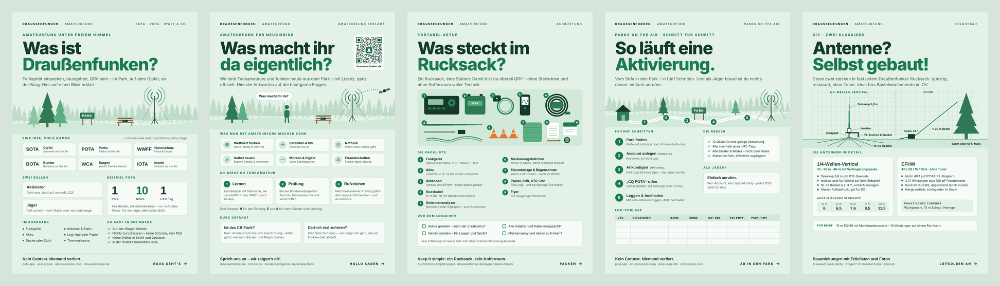
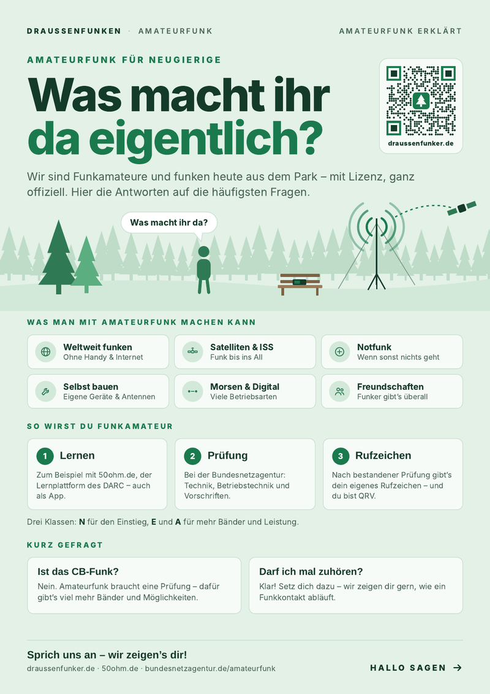
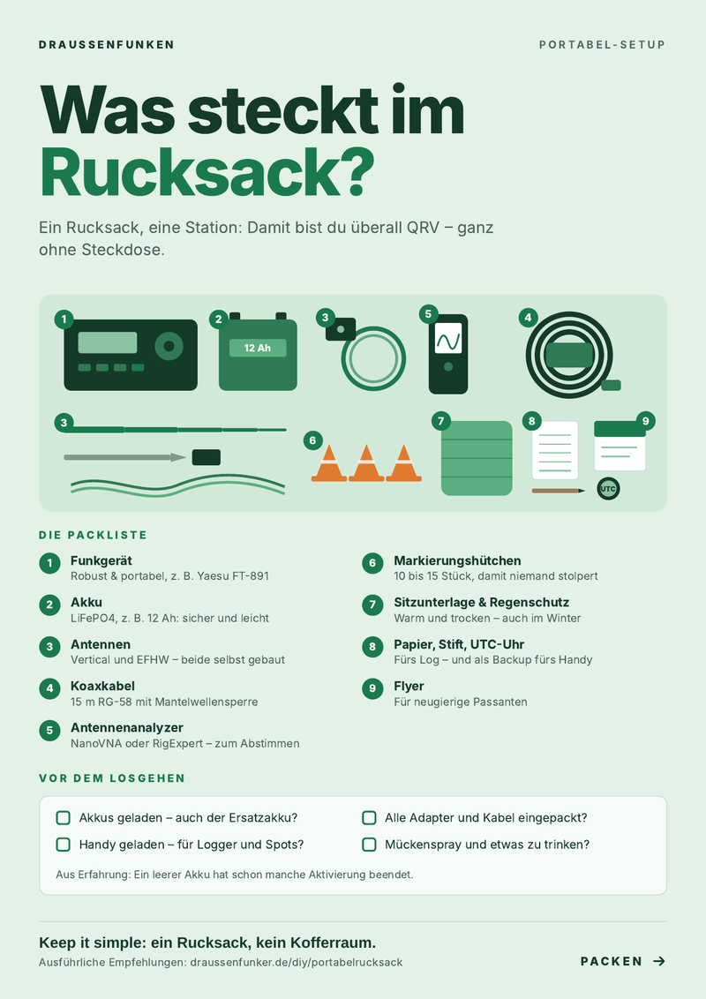
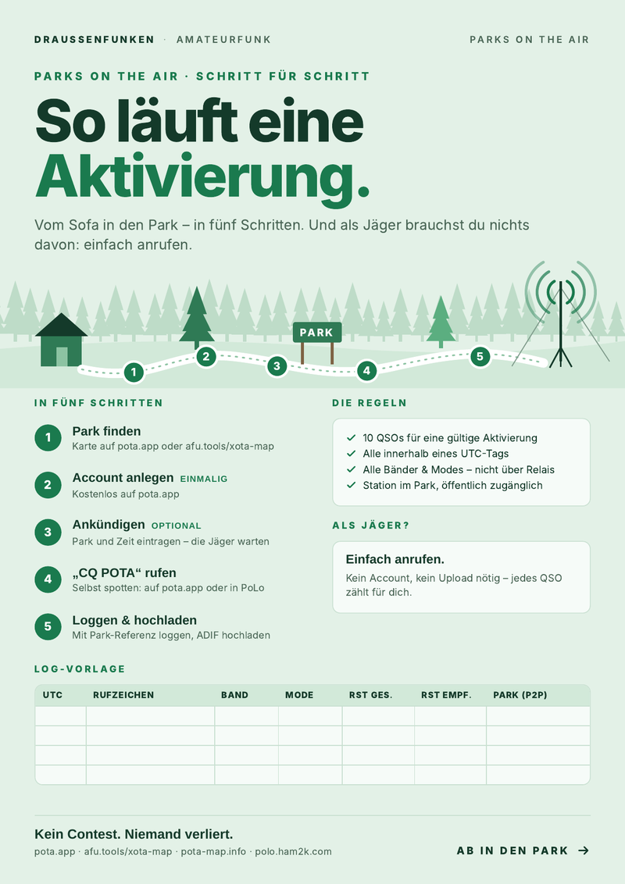

# Draußenfunken – Posterserie

Fünf A4-Poster rund ums Draußenfunken – zum Aushängen im OV-Heim, Auslegen bei Aktivierungen oder Verteilen an Neugierige.
Die Poster sind unabhängig voneinander und können in beliebiger Kombination genutzt werden.



**Online ansehen und herunterladen:** <https://mooxle.github.io/draussenfunken-poster/>

**Mitmachen:** Verbesserungen und neue Poster sind willkommen – siehe [CONTRIBUTING.md](CONTRIBUTING.md).

## Die Poster

<table>
  <tr>
    <td width="33%" valign="top">
      <a href="screenshots/was-ist-draussenfunken.png"></a>
      <p><b>Was ist Draußenfunken?</b><br>
      Das Hauptposter: die Idee hinter SOTA, POTA, WWFF &amp; Co., Aktivierer und Jäger, POTA in drei Zahlen, Packliste und Rücksicht in der Natur.<br>
      <code>poster/was-ist-draussenfunken.html</code></p>
    </td>
    <td width="33%" valign="top">
      <a href="screenshots/was-macht-ihr-da.png"></a>
      <p><b>Was macht ihr da eigentlich?</b><br>
      Für Passanten: was Amateurfunk ist, was man damit machen kann und wie man Funkamateur wird (Klassen N, E, A).<br>
      <code>poster/was-macht-ihr-da.html</code></p>
    </td>
    <td width="33%" valign="top">
      <a href="screenshots/rucksack.png"></a>
      <p><b>Was steckt im Rucksack?</b><br>
      Das Portabel-Setup als nummerierte Packliste plus Checkliste „Vor dem Losgehen“.<br>
      <code>poster/rucksack.html</code></p>
    </td>
  </tr>
  <tr>
    <td width="33%" valign="top">
      <a href="screenshots/aktivierung.png"></a>
      <p><b>So läuft eine Aktivierung</b><br>
      POTA in fünf Schritten, die Regeln, der Hinweis für Jäger und eine Log-Vorlage zum Ausfüllen.<br>
      <code>poster/aktivierung.html</code></p>
    </td>
    <td width="33%" valign="top">
      <a href="screenshots/antennen.png"></a>
      <p><b>Antenne? Selbst gebaut!</b><br>
      Teleskop-Vertical und EFHW mit Skizze, Eckdaten und Tabelle der auszuziehenden Segmente.<br>
      <code>poster/antennen.html</code></p>
    </td>
    <td width="33%" valign="top"></td>
  </tr>
</table>

Fertige Druckdateien liegen in `pdf/`.

## Ansehen

`poster/index.html` im Browser öffnen – von dort sind alle Poster verlinkt.

## Bearbeiten

Jedes Poster ist eine einzelne HTML-Datei ohne Build-Schritt oder Framework. Einfach im Texteditor öffnen, Text ändern, im Browser neu laden.

- **Texte** stehen direkt im HTML.
- **Farben** stehen zentral in `poster/style.css` (Abschnitt `:root`). Eine Änderung dort wirkt auf alle Poster –
  z. B. `--accent` für die Akzentfarbe.
- **Illustrationen** sind Inline-SVG direkt im Poster. Farben dort ebenfalls über die CSS-Variablen (`style="fill: var(--green)"`).
- **Größe:** Ein Poster ist genau 794 × 1123 px = A4 bei 96 dpi. Der Inhalt darf nicht über diese Fläche hinauswachsen –
  nach Textänderungen also im Browser prüfen, ob nichts abgeschnitten wird oder über Kästen hinausläuft.

Schriften: [Inter und Inter Tight](https://fonts.google.com/specimen/Inter) (SIL Open Font License), geladen über Google Fonts.
Zum Bearbeiten und Drucken wird deshalb eine Internetverbindung gebraucht.

## Drucken / PDF erzeugen

**Im Browser:** Poster öffnen → Drucken → Papierformat A4, Ränder „Keine“, Hintergrundgrafiken an → „Als PDF sichern“.

**Per Kommandozeile** (alle Poster auf einmal, braucht Google Chrome):

```sh
./make-pdf.sh
```

Das Skript schreibt die PDFs nach `pdf/`.

## Screenshots aktualisieren

Die Bilder in `screenshots/` sind aus den PDFs gerendert. Nach Änderungen an einem Poster erst die PDFs neu erzeugen,
dann zum Beispiel mit Poppler (`brew install poppler`):

```sh
for f in pdf/*.pdf; do pdftoppm -r 96 -png -singlefile "$f" "screenshots/$(basename "$f" .pdf)"; done
```

Bei jedem Push baut außerdem eine GitHub Action die PDFs und veröffentlicht die Poster-Seite auf GitHub Pages
(`.github/workflows/poster.yml`).

## Quellen

Inhalte basieren auf dem Vortrag „Wetterau on the Air“ (DA6MAX) und den Seiten von [draussenfunker.de](https://draussenfunker.de),
u. a. dem Portabelrucksack-Artikel und den Bauanleitungen für die Teleskop-Vertical und die EFHW.

## Lizenz

[](https://creativecommons.org/licenses/by-nc-sa/4.0/deed.de)

© 2026 DA6MAX und Mitwirkende. Die Poster stehen unter der
[Creative Commons Namensnennung – Nicht kommerziell – Weitergabe unter gleichen Bedingungen 4.0 International](https://creativecommons.org/licenses/by-nc-sa/4.0/deed.de) (CC BY-NC-SA 4.0).
Du darfst sie frei nutzen, drucken, verteilen und verändern – mit Namensnennung, nicht kommerziell und unter derselben Lizenz.
Vollständiger Lizenztext: [LICENSE](LICENSE).

Die Schriften Inter und Inter Tight stehen unter der SIL Open Font License und sind nicht Teil dieses Repos.
